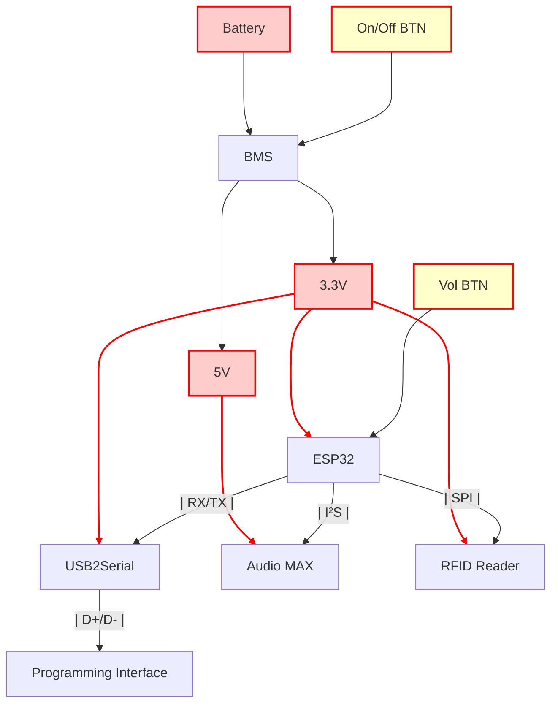
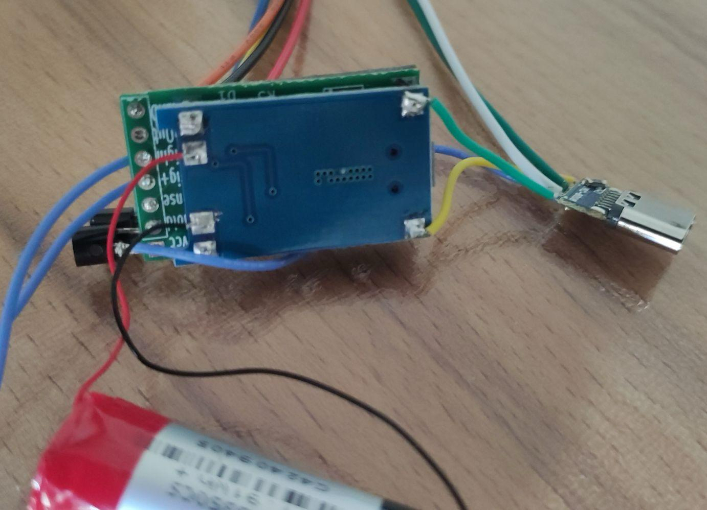
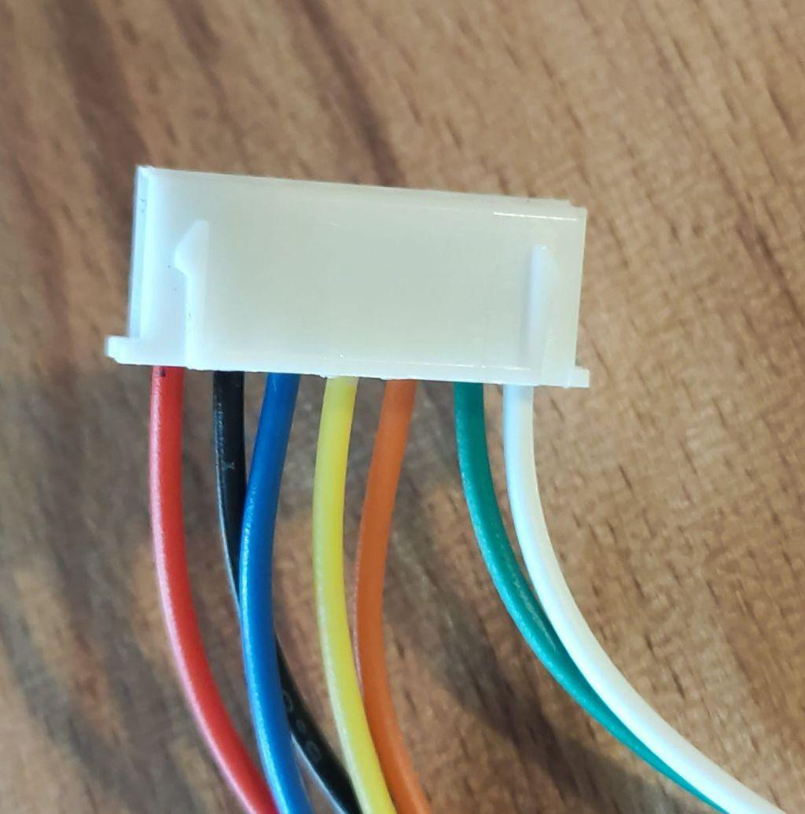
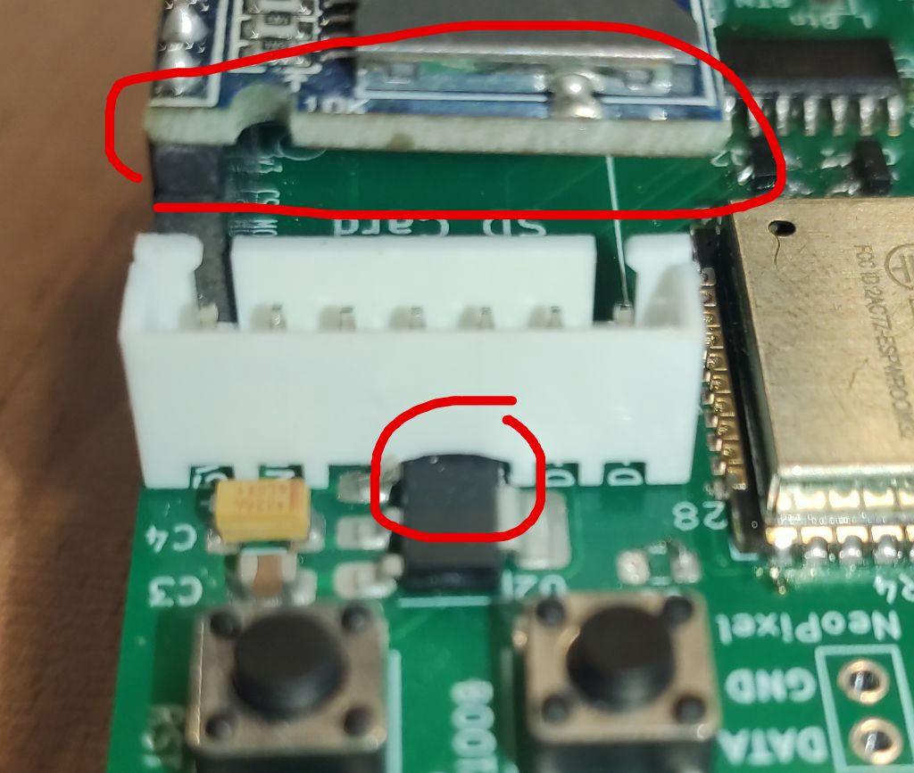
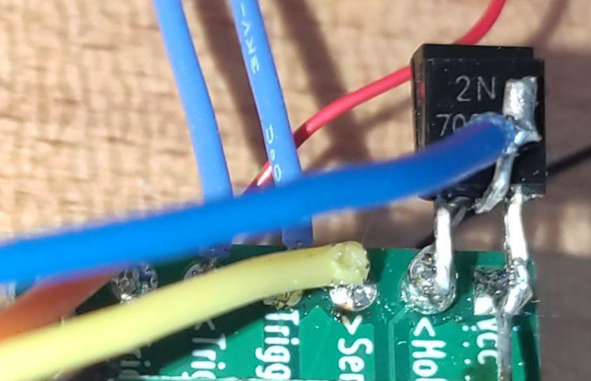
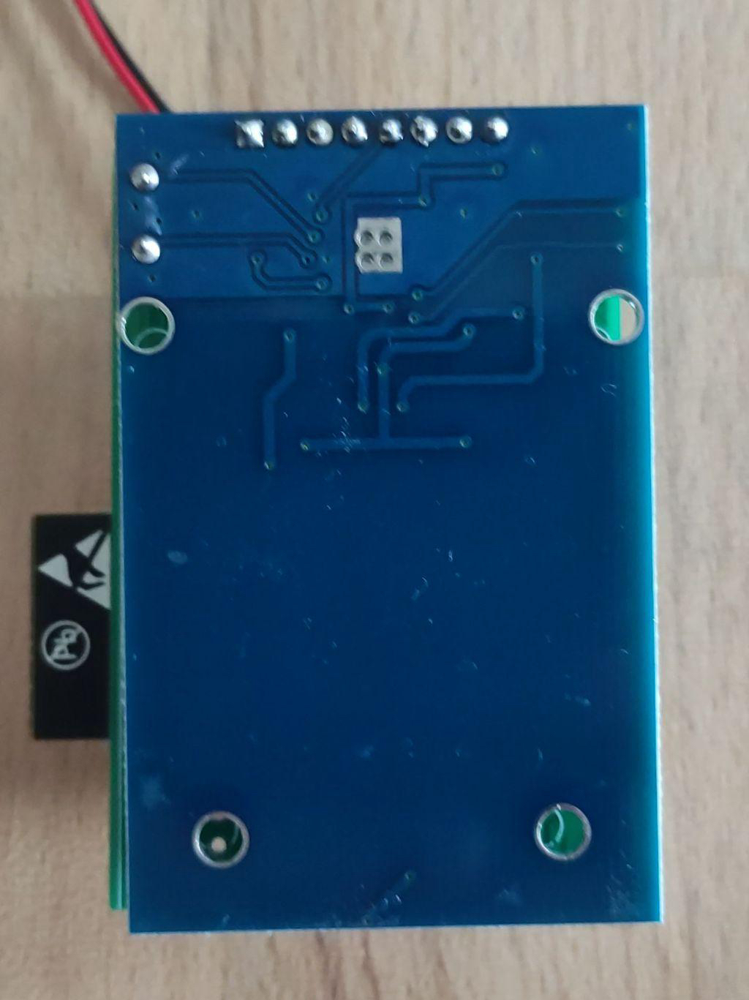
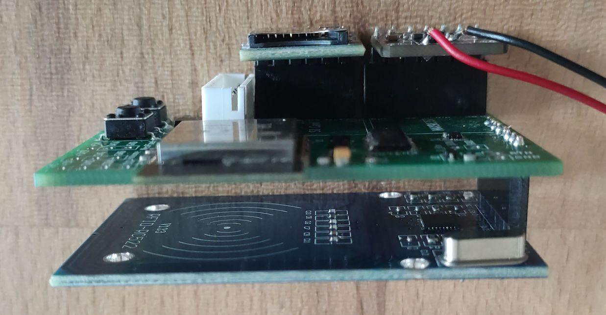
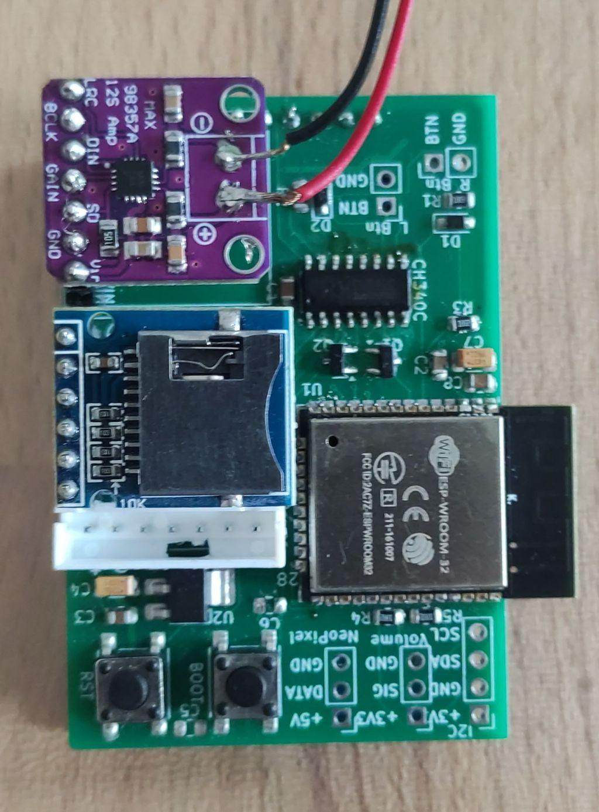
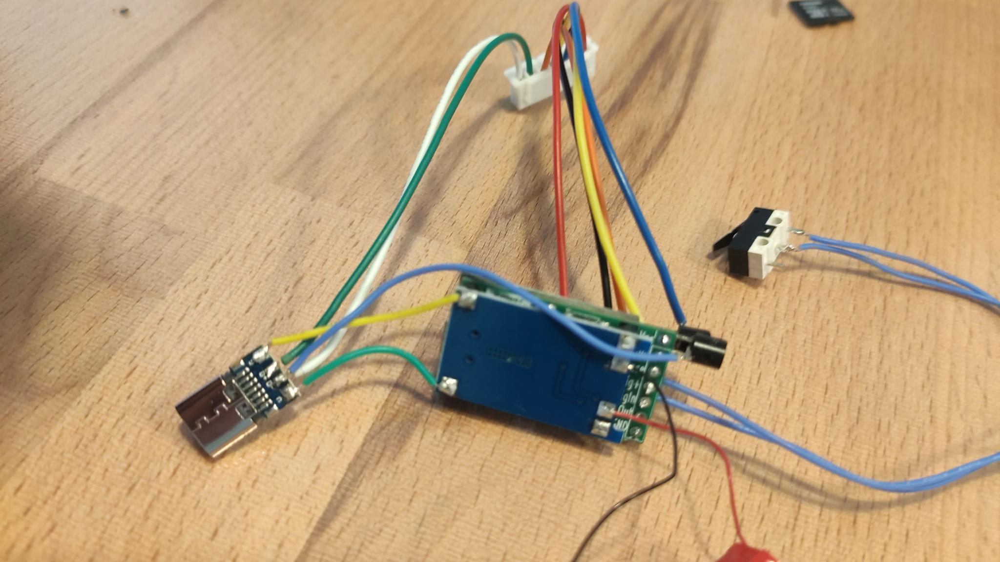

# Timon Box
## Hardware Bring up instructions

### Architecture

### Fotos









### Knock-Sensoren (Vor / Zurück)
Je ein Piezo-Element ist auf eine leicht flexible Fläche geklebt, parallel dazu 100 kΩ und eine 3,3-V-Zenerdiode,
gelesen über den ADC (GPIO 34 / 35). Beim Drücken fließt über den Widerstand ein Strom proportional zur
Bewegungsgeschwindigkeit: der ADC sieht *einen* zusammenhängenden Buckel, dessen Fläche der Auslenkung entspricht.
Musik schüttelt die Fläche auch, aber als Schwingung – lauter Halbwellen mit Nullpausen dazwischen. `src/knock.cpp`
erkennt einen Druck deshalb an der Form eines einzelnen Buckels (Dauer oder Fläche), nicht am gefilterten Pegel.
Dafür muss der ADC deutlich öfter gelesen werden als eine Halbwelle dauert; die Hauptschleife kommt während der
Wiedergabe nur alle ~9 ms vorbei (`audio.loop()` wartet auf den I²S-Puffer), also tastet ein `esp_timer` mit 2 kHz
auf Core 0 ab. Nur die Aktion (Titel wechseln, Klick) läuft in der Hauptschleife.

Abstimmen über die serielle Konsole:
- `knockdebug:1` – pro Sekunde und Sensor: Sample-Rate, Anzahl Buckel, längster Buckel, Peak, größte Fläche. Bei lauter
  Musik zeigt das den Abstand zu den Auslöseschwellen.
- `knockdebug:2` – zusätzlich einmalig den Rohsignalverlauf des nächsten Buckels ausgeben (µs:Counts).
- Jeder erkannte Druck meldet `press after <ms>, peak, area`: `after` ≥ `KNOCK_MIN_PRESS_MS` heißt, das Dauer-Kriterium
  hat gefeuert, sonst die Fläche.

Die Schwellen stehen pro Box in der `platformio.ini`, weil die Gehäusewände unterschiedlich dick sind:
`RKS_THRESHOLD`/`LKS_THRESHOLD` (Fläche eines Buckels in Counts × ms), `KNOCK_ON_LEVEL` (Pegel, ab dem ein Buckel zählt;
er endet unter 3/5 davon), `KNOCK_MIN_PRESS_MS` (Dauer, ab der ein ununterbrochener Buckel ein Druck ist) und
`KNOCK_MAX_GAP_US` (kürzere Einbrüche beenden den Buckel nicht). Eine dünne, lebhafte Wand braucht höhere Pegel und
Flächen, längere Mindestdauer und kürzere erlaubte Pausen.

Der 100-kΩ-Widerstand bildet mit der Piezo-Kapazität (~20–50 nF) einen Hochpass um 30–80 Hz und dämpft damit gerade
langsame Drücke, während Töne kaum betroffen sind. Unter ~0,1 V liest der ESP32-ADC 0. Wer sanftes, langsames Drücken
braucht, tauscht den Widerstand gegen 1 MΩ: langsame Drücke werden etwa 5–10× größer, tiefe Töne höchstens 1,6×.

## Software Instruction
### IDE
Visual Studio Code with Platform IO Extension (platformio.platformio-ide)

### Zustandsautomat
[doc/state-machine.html](doc/state-machine.html) zeigt die Zustände der Firmware (Wiedergabe, Bluetooth, Management-Modus mit Netzmodus und Token-Regeln) als Mermaid-Diagramme in den LED-Farben, dazu alle Timeouts mit ihren Konstanten. Im Browser öffnen; Mermaid wird vom CDN geladen.

### Weiter an der gemerkten Stelle
Die Box merkt sich in `last_played.txt` neben dem zuletzt gespielten Titel eine zweite Zeile mit der Byte-Position:
beim Abnehmen des Tokens, jede Minute während der Wiedergabe und vor dem Ausschalten am Albumende. Beim nächsten
Auflegen läuft der Titel ~5 s vor dieser Stelle weiter (`RESUME_REWIND_S`), auch nach dem Ausschalten. „Play next“ in
der Web-UI und Dateien älterer Firmware haben keine zweite Zeile und beginnen von vorn.

### Podcast-Alben
Liegt im Albumordner eine `podcast.txt` (Zeile 1: Feed-Adresse, optional `keep=N`), ist der Token ein Podcast. Am
einfachsten setzt man sie im Management-Modus auf der Seite „Podcast“ (eigener Reiter vor „Wi-Fi“); dort gibt es auch
eine Suche im Apple-Podcast-Verzeichnis, die die Feed-Adresse einträgt. Die Box nutzt das auf der Wi-Fi-Seite gespeicherte
Heimnetz.

Beim Auflegen (LED pulsiert grün) verbindet sich die Box mit dem WLAN, liest den Feed und nimmt die **neueste Folge**
(nach `pubDate`, Trailer zählen nicht):
- liegt sie schon ganz auf der Karte, spielt sie sofort von dort, ohne Download;
- liegt sie teilweise da, spielt der Teil, und der Rest kommt per HTTP-Range nach;
- fehlt sie, wird sie geladen und spielt, sobald 64 kB da sind, während der Rest im Hintergrund kommt.

Ohne WLAN, bei einem Fehler oder nach 20 s spielt die neueste Folge auf der Karte. Folgen heißen
`2026-10-19_0400_<Titel>_<id>.mp3`, sortieren also nach Datum; nach dem Ende einer Folge kommt die nächstältere, nach der
ältesten geht die Box aus. Die neuesten 30 Folgen (`keep`) bleiben, ältere werden gelöscht. `podcast_state.txt` hält fest,
was die Box zuletzt gefunden hat; die Web-UI zeigt das an. Unterstützt werden MP3-Podcasts (der weit überwiegende Teil),
für andere Formate meldet die Web-UI „not supported yet“.

Technik: Der Podcast-Task läuft auf Core 0 und schreibt die Folge in 4-kB-Blöcken. Die Wiedergabe liest die wachsende
Datei über ein eigenes Dateisystem (`src/gated-fs.h`), das die Endgröße meldet und nur gesicherte Daten herausgibt;
belegt der Download die Karte, liest die Wiedergabe aus ihrem Puffer weiter, statt zu warten. TLS nur für den Feed,
bevor etwas spielt; die Folge selbst kommt bevorzugt per `http://` (spart ~45 kB RAM). Ein großer ID3-Tag am Anfang
(Cover, beim WDR 0,8 MB) wird beim Download weggelassen. Im Player-Modus gibt die Box den nie genutzten
Bluetooth-Speicher (~55 kB) frei; Bluetooth läuft ohnehin nur nach einem Neustart in den Bluetooth-Modus. Die
I2S-DMA-Puffer sind auf 16 kB halbiert, damit auch eine Folge nur per HTTPS neben der Wiedergabe Platz hat.

Was dabei auffiel:
- Der Podcast-Task greift **direkt über FATFS** auf die Karte zu, mit eigenen Dateiobjekten. Liefen beide Tasks über
  VFS und stdio, zerstörte ein Titelwechsel während des Downloads die Dateien beider Seiten (EBADF beim Schreiben,
  EACCES beim Lesen). Über das VFS sind höchstens 5 Dateien offen; jede belegt dauerhaft einen 4-kB-Sektorpuffer.
- Der SD-Treiber des Arduino-Cores meldet ein Schreiben als fehlgeschlagen, sobald nach einem Mehrsektor-Schreiben im
  Kartenstatus irgendein Bit gesetzt ist. Auf Julius' Karte passiert das alle paar hundert kB, obwohl die Daten da sind.
  Der Download öffnet die Datei dann neu, prüft ihre Größe und schreibt den Block noch einmal. Er gibt erst auf, wenn
  das fünfmal ohne 64 kB Fortschritt dazwischen passiert. Die MD5-Summen geladener Folgen stimmen mit `curl` überein.
- Bringt eine Verbindung weniger als 8 kB/s über 15 s, baut der Download sie neu auf.

Host-Tests für Feed-Parser, Dateinamen und Fortsetzungslogik (echte Feeds verschiedener Hoster als Testdaten):
`tools/host-test.sh`. Serielle Befehle zum Prüfen auf der Box: `podcast`, `audio`, `heap[:<s>]`, `md5:<pfad>`,
`podcasturl:<url> [<keep>]` (setzt den Feed des aufgelegten Albums), `dl:<url>` / `dlplay` / `dlstop` / `dlclean`
(löscht die Testdateien von `dl:`).

### Token-Bogen
[tools/token-sheet.html](tools/token-sheet.html) erzeugt den 10 × 15 cm Fotoabzug mit sechs runden Token-Bildern, gleiches Layout wie `src/prepare_tokens.py` (1772 × 1181 px, Kreise mit 515 px). Die Seite ist eine einzelne HTML-Datei ohne Server und ohne Abhängigkeiten, im Look der Management-Web-UI, und führt in drei Schritten durch den Ablauf: Bilder sammeln (Fotos, Kamera, Web-Links, Einfügen, Drag & Drop), jedes Bild im Kreis zuschneiden (Verschieben, Pinch-Zoom, Drehen), fertigen Bogen teilen oder als JPEG speichern. Die Bilder verlassen das Gerät nicht; eine angefangene Sitzung bleibt im Browser gespeichert.

Web-Links funktionieren nur, wenn die Seite den direkten Zugriff erlaubt (CORS); sonst das Bild im Browser kopieren oder speichern und als Datei hinzufügen.

#### Fürs Handy: die Android-App

[android/](android/) packt genau diese Datei in eine App. Sie läuft offline und überall, ohne Server und ohne Heimnetz.

```bash
cd android
./setup-toolchain.sh   # einmalig: JDK und Android-SDK
./deploy.sh            # bauen, per USB installieren, starten
```

`deploy.sh` kennt außerdem `--no-build` (nur neu installieren) und `--run-only` (nur neu starten). `tools/token-sheet.html` bleibt die einzige Quelle der Seite; Gradle kopiert sie beim Bauen ins APK. Wer nur die Seite ändert, ruft trotzdem `./deploy.sh` auf, denn ohne Server gibt es keinen anderen Weg aufs Telefon.

Die App ist eine Hülle um einen WebView und reicht drei Dinge nach, die dort fehlen: **Teilen**, **Speichern** und **Bilder empfangen**. Die Android-WebView kennt `navigator.share` nicht, und ein `<a download>` bleibt dort wirkungslos. Die App nimmt das fertige JPEG deshalb über eine native Brücke entgegen, öffnet damit den echten Teilen-Dialog und legt den Bogen unter *Bilder / Token Sheet* in der Galerie ab. Ohne App verhält sich `tools/token-sheet.html` unverändert wie vorher und lässt sich weiterhin einfach im Browser öffnen.

Umgekehrt ist die App auch ein **Empfänger für Bilder**: in der Galerie, im Browser oder sonstwo auf Teilen tippen, *Token Sheet* wählen, und das Bild landet im nächsten freien Platz. Mehrere auf einmal gehen auch, sie füllen die nächsten freien Plätze der Reihe nach. Läuft die App gerade beim Zuschneiden oder beim fertigen Bogen, springt sie zurück auf die Bilderübersicht. Ist der Bogen voll, sagt sie das und ändert nichts.

Die hereingereichten Bilder gehen nicht durch die Brücke, sondern werden in den Cache kopiert und der Seite unter derselben Herkunft ausgeliefert, unter der auch die Seite selbst läuft. Ein Handyfoto als `data:`-URL wären sonst schnell acht Megabyte Base64 quer durch `evaluateJavascript`.

Berechtigungen: nur Internet, für die Bild-Links. Die Kamera läuft über die Kamera-App, das Speichern über den MediaStore. Auf einem iPhone bleibt nur die Datei im Browser, dort ohne Teilen-Knopf.

### MAC Fix

Error with ESP Async Webserver can be fixed with changing the platformio.ini to:

lib_deps = 
	https://github.com/schreibfaul1/ESP32-audioI2S.git
	miguelbalboa/MFRC522@^1.4.10
	https://github.com/pschatzmann/ESP32-A2DP.git
	;me-no-dev/ESP Async WebServer @ 1.2.4
    https://github.com/me-no-dev/ESPAsyncWebServer.git
    https://github.com/me-no-dev/AsyncTCP.git

Compiling .pio/build/esp32dev/libf11/SPI/SPI.cpp.o
In file included from /Users/dennis/Documents/Development/TimonBox/timon-box/src/main.ino:9:
.pio/libdeps/esp32dev/ESP32-A2DP/src/BluetoothA2DPSink.h:23:2: warning: #warning "AudioTools library is not included first or installed" [-Wcpp]
 #warning "AudioTools library is not included first or installed"

lib_deps = 
    + https://github.com/pschatzmann/ESP32-A2DP.git
    + https://github.com/pschatzmann/arduino-audio-tools.git


