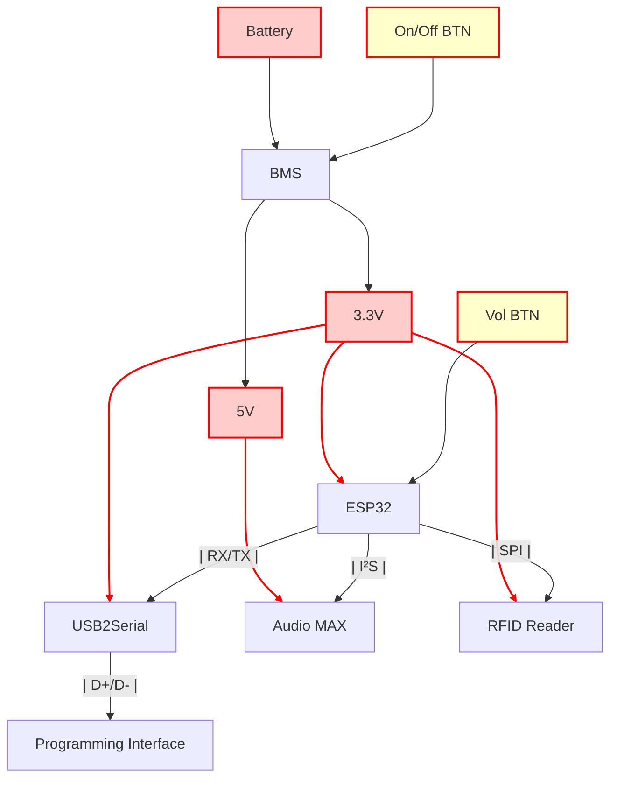

# Timon Box
## Hardware Bring up instructions

### Architecture

### Fotos

## Software Instruction
### IDE
Visual Studio Code with Platform IO Extension (platformio.platformio-ide)

### MAC Fix

Error with ESP Async Webserver can be fixed with changing the platformio.ini to:

lib_deps = 
	https://github.com/schreibfaul1/ESP32-audioI2S.git
	miguelbalboa/MFRC522@^1.4.10
	https://github.com/pschatzmann/ESP32-A2DP.git
	;me-no-dev/ESP Async WebServer @ 1.2.4
    https://github.com/me-no-dev/ESPAsyncWebServer.git
    https://github.com/me-no-dev/AsyncTCP.git

Compiling .pio/build/esp32dev/libf11/SPI/SPI.cpp.o
In file included from /Users/dennis/Documents/Development/TimonBox/timon-box/src/main.ino:9:
.pio/libdeps/esp32dev/ESP32-A2DP/src/BluetoothA2DPSink.h:23:2: warning: #warning "AudioTools library is not included first or installed" [-Wcpp]
 #warning "AudioTools library is not included first or installed"

lib_deps = 
    + https://github.com/pschatzmann/ESP32-A2DP.git
    + https://github.com/pschatzmann/arduino-audio-tools.git

