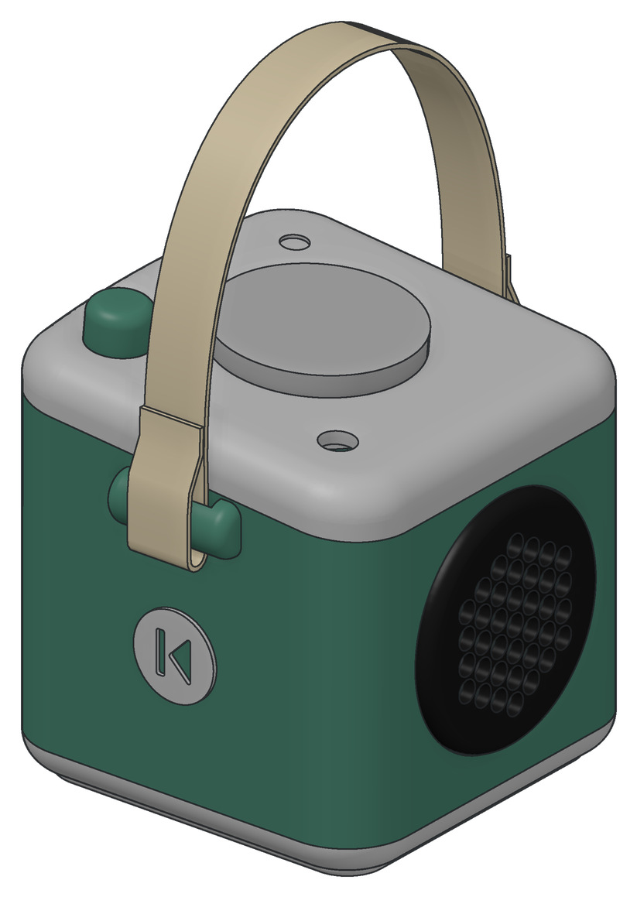
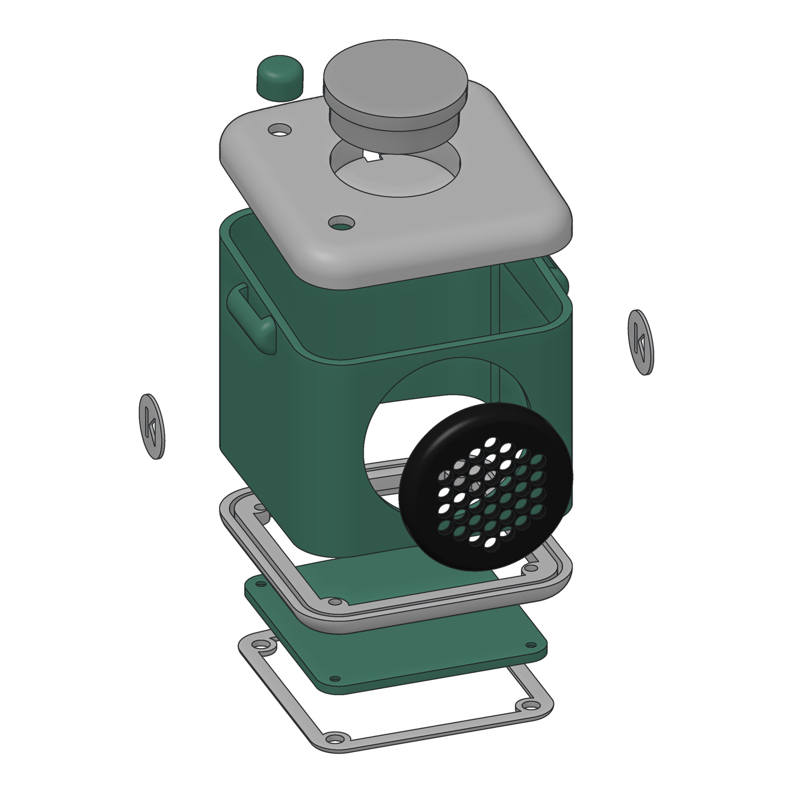
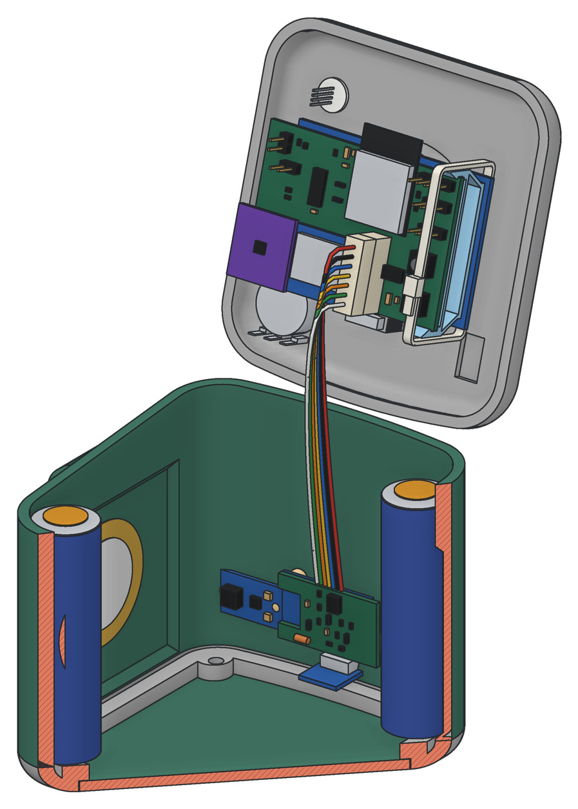

# Timon Box

Eine Hörbox für Kinder zum Selberbauen: Figur auflegen, Musik läuft. Ein Druck auf die Seite springt zum nächsten
Titel, ein Drehknopf regelt die Lautstärke. Hörspiele, Lieder und Podcasts kommen über WLAN auf die Box, ohne Cloud
und ohne Konto.

<p align="center">
  
</p>

## Was sie kann

- **Token auflegen, Musik läuft.** Jedes Album ist ein gedruckter Token mit NFC-Tag und eigenem Bild. Abnehmen hält
  an, wieder auflegen spielt an derselben Stelle weiter.
- **Für kleine Hände.** Auf die linke Seite drücken heißt zurück, auf die rechte vor. Dazu ein Drehknopf für die
  Lautstärke und eine LED, die zeigt, was die Box gerade tut.
- **Podcasts.** Ein Token kann einem Podcast folgen. Beim Auflegen holt die Box die neueste Folge selbst aus dem Netz.
- **Musik über den Browser.** Mit dem Management-Token öffnet die Box eine Web-Oberfläche. Dort lädt man Titel hoch,
  richtet Podcasts ein und kopiert Alben von einer zweiten Box.
- **Bluetooth-Lautsprecher.** Ein eigener Token macht aus der Box einen Lautsprecher fürs Handy.
- **Akku und USB-C.** Zwei 18650-Zellen, geladen und geflasht über dieselbe Buchse. Ein kleiner Lichtleiter zeigt, ob
  sie lädt, und ein Gurt macht die Box tragbar.

## Selbst bauen

Die Box besteht aus einem 3D-gedruckten Gehäuse, zwei kleinen Platinen und ein paar fertigen Modulen: ESP32,
Verstärker, SD-Karte, RFID-Leser und Lademodul. Man braucht einen 3D-Drucker und einen Lötkolben mit feiner Spitze,
denn einige Bauteile sind SMD in 0805.

**Die Bauanleitung [doc/assembly.pdf](doc/assembly.pdf) führt durch alles:** Teileliste, Platinen bestücken, Gehäuse
drucken, zusammenbauen und die Firmware aufspielen. Jeder Schritt hat ein Bild.

<p align="center">
  
  &nbsp;&nbsp;
  
</p>

| Was | Wo |
|---|---|
| Fertige Druckbetten, eins pro Farbe, für PrusaSlicer und Bambu Studio | [models/plates/](models/plates/) |
| Druckteile einzeln als STL, schon in Druckausrichtung | [models/stl/](models/stl/) |
| Gehäuse und Abstandshalter als STEP | [models/](models/) |
| Platinen: KiCad, Gerber und Schaltpläne | [hardware/](hardware/) |
| Elektronik im Detail | [doc/hardware.md](doc/hardware.md) |

## Firmware aufspielen

Gebaut wird mit [PlatformIO](https://platformio.org), zum Beispiel in VS Code mit der PlatformIO-Erweiterung. Die Box
mit einem Token einschalten, über USB-C an den Rechner stecken, dann:

```bash
git clone https://github.com/aaronblankenburg/timon-box
cd timon-box
pio run -e timon -t upload
```

Die eigene Box bekommt eine eigene Env in der `platformio.ini`: Name, Farbe, die beiden Sondertokens,
Akku-Kalibrierung und Klopfschwellen. Wie man die Werte herausfindet, steht in der Bauanleitung in Kapitel 5.5.

## Tokens basteln

Die Bilder entstehen mit [tools/token-sheet.html](tools/token-sheet.html): im Browser öffnen, sechs Bilder wählen und
zuschneiden, als Fotoabzug 10 × 15 cm bestellen. Ausgeschnitten kommen sie mit doppelseitigem Klebeband auf die
Tokens. Die Tokens selbst sind gedruckt, der NFC-Tag kommt während des Drucks hinein. Fürs Handy gibt es die Seite auch
als Android-App in [android/](android/).

## Mehr lesen

| Datei | Inhalt |
|---|---|
| [doc/usage.md](doc/usage.md) | Bedienung: Tokens, LED, Musik hochladen, Podcasts, Bluetooth |
| [doc/assembly.pdf](doc/assembly.pdf) | Bauanleitung: Elektronik, Druck und Zusammenbau |
| [doc/hardware.md](doc/hardware.md) | Elektronik: Teile, Platinen, Verkabelung, Inbetriebnahme |
| [doc/architecture.md](doc/architecture.md) | Firmware Modul für Modul |
| [doc/development.md](doc/development.md) | Entwickeln: Klopfsensoren, Podcast-Technik, Tests, Android-App |
| [doc/state-machine.html](doc/state-machine.html) | Zustände der Firmware als Diagramm |
| [CLAUDE.md](CLAUDE.md) | Kurzfassung für die Arbeit mit Claude Code |

## Lizenz

Nachbauen, verändern und weitergeben ist ausdrücklich erwünscht, Geld verdienen damit nicht. Gehäuse, Platinen und
Doku stehen deshalb unter [CC BY-NC-SA 4.0](https://creativecommons.org/licenses/by-nc-sa/4.0/deed.de), Firmware und
Werkzeuge unter der [GPL-3.0](https://www.gnu.org/licenses/gpl-3.0.html). Was genau wofür gilt, steht in
[LICENSE.md](LICENSE.md). Wer die Box kommerziell nutzen möchte, etwa als Bausatz, fragt bitte vorher über ein Issue.
