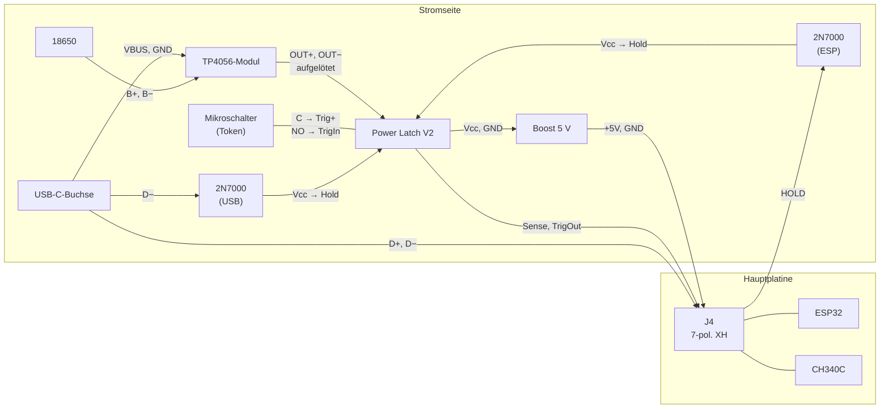

# Hardware: Teile, Platinen, Verkabelung

Diese Datei beschreibt, wie man eine Box nachbaut. Wie die Firmware die Pins benutzt, steht in
[architecture.md](architecture.md), Abschnitt 1. Wie die Klopfsensoren funktionieren und wie man sie abstimmt, steht
im [README](../README.md#knock-sensoren-vor--zurück).

Stand: Oktober 2026. So sind die Boxen Timon und Julius gebaut.

## Überblick

Die Box besteht aus zwei Platinen und ein paar lose verdrahteten Teilen:

- **Hauptplatine** (40,9 × 60,5 mm): ESP32, USB-seriell-Wandler CH340C, 3,3-V-Regler und drei Module auf
  Buchsenleisten: I²S-Verstärker MAX98357A und SD-Karte oben, RFID-Leser RC522 unten.
- **Power Latch V2** (31,3 × 18,3 mm): Lademodul TP4056, Umschaltung zwischen USB und Akku und die Selbsthaltung.
  Ein Mikroschalter schaltet die Box ein, wenn ein Token aufgelegt wird. Danach hält der ESP32 die Box selbst an.
  Anders lässt sie sich nicht einschalten, auch nicht über USB.
- **Lose verdrahtet:** 18650-Zelle, USB-C-Buchse, Boost-Wandler auf 5 V, zwei 2N7000, Mikroschalter, zwei Piezos,
  Poti, LED und Lautsprecher.

Ein 7-poliges Kabel verbindet die Hauptplatine mit der Stromseite. Über dieses Kabel laufen auch die USB-Datenleitungen.
Die USB-C-Buchse am Gehäuse lädt also den Akku und dient zugleich zum Flashen.

## Dateien

| Pfad | Inhalt |
|---|---|
| `hardware/mainboard/` | KiCad-Projekt der Hauptplatine (`timon-box.kicad_*`), Footprints der Module in `Library.pretty` |
| `hardware/mainboard/timon-box-schematic.pdf` | Schaltplan |
| `hardware/mainboard/timon-box-gerber.zip` | Gerber und Bohrdaten, 2 Lagen |
| `hardware/power-latch/` | KiCad-Projekt der Power Latch V2 (`power-latch-v2.kicad_*`), Footprint des TP4056-Moduls |
| `hardware/power-latch/power-latch-v2-schematic.pdf` | Schaltplan |
| `hardware/power-latch/power-latch-v2-gerber.zip` | Gerber und Bohrdaten, 2 Lagen |
| `sdcard/` | `tap.mp3` und `alert.mp3` fürs Wurzelverzeichnis der SD-Karte |

Die Projekte sind mit KiCad 8 gezeichnet. Die Symbole stecken im Schaltplan, die Footprints in der Platine. Die Gerber
sind mit `kicad-cli` aus den Platinen erzeugt. Wer die Platine ändert, füllt vor dem Export die Flächen neu (Taste
`B`). Mit der alten Füllung berührte eine SD-Leitung die Massefläche.

## Teileliste

### Module und Einzelteile

| Teil | Anzahl | Anmerkung |
|---|---|---|
| ESP32-WROOM-32, -32D oder -32E | 1 | Ohne PSRAM. Ein WROVER geht nicht, dort belegt der PSRAM GPIO 16 und 17, die SD-Karte braucht sie |
| MAX98357A-Modul | 1 | I²S-Verstärker. 7 Pins: LRC, BCLK, DIN, GAIN, SD, GND, VIN |
| microSD-Modul für 3,3 V | 1 | 6 Pins: 3V3, CS, MOSI, CLK, MISO, GND. Die Platine wird gekürzt, siehe Hauptplatine |
| RC522-Modul | 1 | RFID mit 13,56 MHz. 8 Pins, sitzt unter der Hauptplatine |
| TP4056-Lademodul mit Schutzschaltung | 1 | Wird auf die Rückseite der Power Latch gelötet |
| Boost-Modul mit festen 5 V | 1 | Manche Module stellt man erst mit Lötbrücken auf 5 V |
| 18650-Zelle | 1 | Eine einfache Li-Ion-Zelle. Die Schutzschaltung sitzt auf dem TP4056-Modul |
| USB-C-Buchse auf kleiner Platine | 1 | Mit 5,1 kΩ an CC1 und CC2, sonst liefern USB-C-Netzteile keine 5 V. D+ und D− müssen herausgeführt sein |
| 2N7000 (TO-92) | 2 | Umbau an der Power Latch, siehe dort |
| Mikroschalter 12,8 × 5,8 mm | 1 | Wechsler mit C, NO und NC. Der Token drückt ihn |
| Piezo-Scheibe, etwa 35 mm | 2 | Klopfsensoren für Vor und Zurück |
| Poti 10 kΩ linear | 1 | Lautstärke |
| PL9823, 8 mm | 1 | Bedrahtete RGB-LED mit eingebautem Controller, Farbreihenfolge RGB (`NEO_RGB` in `main.ino`) |
| Lautsprecher, 3 W | 1 | Klein, 4 oder 8 Ω |
| JST-XH-Buchse 7-polig, stehend, mit Stecker | 1 | 2,5 mm Raster, für das Kabel zur Stromseite |
| Buchsenleisten und Stiftleisten, 2,54 mm | | 7-polig für den Verstärker, 6-polig für die SD-Karte, 8-polig für das RC522 |
| microSD-Karte | 1 | FAT32 |
| NFC-Klebetags, rund, 25 mm | je Token | 13,56 MHz, NXP NTAG mit 7-Byte-UID. Sie werden beim 3D-Druck in den Token eingelegt |

### Hauptplatine

| Bauteil | Wert | Bauform | Aufgabe |
|---|---|---|---|
| U1 | ESP32-WROOM-32(D/E) | Modul | |
| U2 | AMS1117-3.3 | SOT-223 | 3,3 V aus den 5 V vom Kabel |
| U3 | CH340C | SOIC-16 | USB-seriell, ohne Quarz |
| Q1, Q2 | 2N7002 | SOT-23 | Auto-Reset: DTR und RTS steuern EN und IO0 |
| D1, D2 | BZT52C3V3 | SOD-323 | Zenerdioden, begrenzen die Piezo-Spannung auf 3,3 V |
| R1, R2 | 100 kΩ | 0805 | Last parallel zu den Piezos, siehe README |
| R3 | 10 kΩ | 0805 | Pull-up an EN |
| R4, R5 | 10 kΩ | 0805 | Pull-ups für I²C (Reserve) |
| C1, C8 | 100 nF | 0805 | Abblockkondensatoren CH340C und ESP32 |
| C2 | 1 µF | 0805 | Mit R3 die Startverzögerung an EN |
| C3 | 10 µF | 0805 | Eingang AMS1117 |
| C4, C7 | 22 µF | 1206 | 3,3 V |
| C5, C6 | – | 0805 | **Nicht bestücken** |
| SW1, SW2 | Taster 6 × 6 mm | PTS645 | RST und BOOT |
| J4 | JST XH, 7-polig, stehend | | Kabel zur Stromseite. Der Footprint ist eine Stiftleiste, siehe unten |
| J1, J5 | 3-polig | | Poti und LED, Stiftleiste oder Kabel direkt |
| J2, J3 | 2-polig | | Piezos, Stiftleiste oder Kabel direkt |
| J6 | 4-polig | | I²C, Reserve für Erweiterungen. Bleibt frei |
| MAX1 | Buchsenleiste 7-polig | | MAX98357A-Modul |
| U4 | Buchsenleiste 6-polig | | SD-Modul |
| P1 | Buchsenleiste 8-polig, Rückseite | | RC522-Modul |

Am MAX98357A liegt GAIN auf GND, das sind 12 dB. SD bleibt offen. Die Firmware schickt ohnehin mono
(`forceMono`), der Kanal ist also egal.

### Power Latch V2

| Bauteil | Wert | Bauform | Aufgabe |
|---|---|---|---|
| Q1 | AO4606 | SOIC-8 | N- und P-Kanal in einem Gehäuse: P schaltet Vcc, N hält ihn |
| Q2 | BSS138 | SOT-23 | TrigOut, Open Drain zum ESP32 |
| Q3 | BSS138 | SOT-23 | Einschaltimpuls |
| Q4 | AO3401A | SOT-23 | Akku-Zweig der Umschaltung USB/Akku |
| D1 | BAT85 | SOD-323 | Klemmt den Einschaltimpuls nach unten |
| D2 | BAT85 | DO-35, bedrahtet | USB-Zweig der Umschaltung |
| R1, R4, R5, R6, R7 | 10 kΩ | 0805 | R4/R5: Spannungsteiler für Sense |
| R2 | 1 MΩ | 0805 | Pull-down an Hold |
| R3 | 100 kΩ | 0805 | Entlädt C1 |
| C1 | 10 µF | 0805 | Einschaltimpuls |
| C2 | 1 µF | 0805 | Gate des P-Kanals |
| J4 | TP4056-Modul | | Auf der Rückseite aufgelötet |
| J1 | – | | Hier werden die sieben Kabel direkt eingelötet |

## Power Latch V2: wie sie schaltet

- **USB oder Akku:** Die 5 V vom USB kommen über D2 zur Last. Der Akku kommt über Q4. Steckt USB, sperrt Q4. Die Box
  läuft dann vom USB, und das TP4056 lädt den Akku.
- **Schalter:** Der P-Kanal von Q1 liegt zwischen dieser Versorgung und `Vcc`. Er leitet, sobald Q3 oder der N-Kanal
  von Q1 sein Gate auf GND zieht.
- **Einschalten:** Ein Token drückt den Mikroschalter. Der verbindet `Trig+` mit `TrigIn`. Über C1 schaltet Q3 für
  etwa eine Sekunde durch (R3 · C1). Das reicht, damit der ESP32 startet und `HOLD` setzt.
- **Halten:** Liegt `Hold` hoch, hält der N-Kanal von Q1 die Box an. Sonst zieht R2 `Hold` auf GND.
- **Token-Meldung:** Solange der Schalter geschlossen ist, zieht Q2 `TrigOut` auf GND. Der ESP32 liest das an GPIO 32
  mit internem Pull-up. `LOW` heißt, ein Token liegt auf.
- **Akkuspannung:** R4 und R5 teilen `Vcc` durch 2 und geben das auf `Sense`. Der ESP32 misst es an GPIO 39.

### Umbau mit zwei 2N7000

`Hold` der Latch hängt nicht direkt am ESP32. Zwei 2N7000 liegen parallel: Drain an `Vcc`, Source an `Hold`.

| 2N7000 | Gate an |
|---|---|
| ESP | HOLD vom ESP32, Kabel Pin 3 (blau) |
| USB | D− der USB-C-Buchse |

Die beiden bilden ein logisches Oder: `Hold` liegt hoch, wenn der ESP32 `HOLD` setzt oder an D− Spannung liegt. Das
Foto `hw_hack.jpeg` zeigt einen davon auf den Pads `Hold` und `Vcc`. Einschalten kann keiner der beiden. Ist die Box
aus, liegt an `Vcc` keine Spannung.

## Verkabelung

### Kabel zwischen Hauptplatine und Stromseite

Auf der Hauptplatine steckt das Kabel in J4. Auf der Stromseite gehen die Adern einzeln an verschiedene Teile. Pin 1
(+5V) liegt an der Platinenkante neben C4, Pin 7 (D−) zum ESP32 hin.

| Pin J4 | Signal | Ader | ESP32 | Stromseite |
|---|---|---|---|---|
| 1 | +5V | rot | – | Boost OUT+ |
| 2 | GND | schwarz | – | Boost OUT− |
| 3 | HOLD | blau | GPIO 33 | Gate des 2N7000 „ESP“ |
| 4 | SENSE | gelb | GPIO 39 | Latch J1 Pin 3, `Sense 50%` |
| 5 | SW_TOKEN | orange | GPIO 32 | Latch J1 Pin 6, `Trigger Out` |
| 6 | D+ | grün | CH340C | USB-C D+ |
| 7 | D− | weiß | CH340C | USB-C D− und Gate des 2N7000 „USB“ |

### Power Latch, Anschluss J1

| Pin | Beschriftung | an |
|---|---|---|
| 1 | `Vcc` | Boost IN+ und Drain beider 2N7000 |
| 2 | `Hold` | Source beider 2N7000 |
| 3 | `Sense 50%` | Kabel Pin 4 (gelb) |
| 4 | `Trigger +` | Mikroschalter C |
| 5 | `Trigger In` | Mikroschalter NO |
| 6 | `Trigger Out` | Kabel Pin 5 (orange) |
| 7 | `GND` | Boost IN− |

Der NC-Kontakt des Mikroschalters bleibt frei.

### Akku, Laden und USB-C

| von | an |
|---|---|
| USB-C VBUS, GND | TP4056 IN+, IN−. Auf der Latch sind das die Pads `5v +` und GND |
| 18650 Plus, Minus | TP4056 B+, B− |
| TP4056 OUT+, OUT− | Latch `Bat+`, `Bat−`. Das Modul ist dort aufgelötet |
| USB-C D+, D− | Kabel Pin 6 und 7, D− zusätzlich an das Gate des 2N7000 „USB“ |

Das TP4056-Modul sitzt auf der Rückseite der Latch. Seine vier Eckpads (IN+, IN−, OUT+, OUT−) sind direkt auf den
Footprint gelötet.

### Bedienteile an der Hauptplatine

| Anschluss | Pins | GPIO | an |
|---|---|---|---|
| J1 „Volume“ | +3V3, SIG, GND | 36 | Poti: Enden an +3V3 und GND, Schleifer an SIG |
| J2 „R Btn“ | BTN, GND | 34 | Piezo an der **linken** Wand, von vorn gesehen: zurück |
| J3 „L Btn“ | BTN, GND | 35 | Piezo an der **rechten** Wand: vor |
| J5 „NeoPixel“ | +5V, DATA, GND | 2 | PL9823: VDD, DIN, GND. DOUT bleibt frei |
| J6 „I2C“ | +3V3, GND, SDA, SCL | 14, 13 | Reserve, frei |
| MAX98357A | +, − | | Lautsprecher |

Die Beschriftung von J2 und J3 auf der Platine ist seitenverkehrt. In der Firmware sind die Namen ebenfalls vertauscht
(architecture.md, Abschnitt 9). Wer den Piezo von J2 an die linke Wand klebt, bekommt links zurück und rechts vor.

Die Piezos sind rückwärts gepolt: die Messingseite (meist die schwarze Ader) an BTN, die Keramikseite (meist rot) an
GND. Löst ein Piezo erst beim Loslassen statt beim Drücken aus, seine beiden Adern tauschen. Wird die Box beim Drehen
nach links lauter statt leiser, die beiden äußeren Drähte am Poti tauschen.

### Mechanik

- Die Piezos kleben auf leicht flexiblen Gehäusewänden, siehe README.
- Der Token liegt parallel über dem RC522 und drückt den Mikroschalter seitlich.
- Das RC522 sitzt mit Stift- und Buchsenleiste unter der Hauptplatine. Der Abstand ergibt sich aus den Leisten.

## Aufbau

### Hauptplatine

1. SMD-Teile bestücken: CH340C, AMS1117, die beiden 2N7002, Widerstände, Kondensatoren, Zenerdioden. C5 und C6 bleiben
   frei.
2. ESP32-Modul und die beiden Taster einlöten.
3. **J4:** Der Footprint ist eine 2,54-mm-Stiftleiste. Eingebaut ist eine JST-XH-Buchse mit 2,5 mm Raster, die
   passt in dieselben Löcher. Ihr Gehäuse ist tiefer als eine Stiftleiste und stößt an den AMS1117 (U2). Das Gehäuse
   deshalb an der Unterseite über dem Regler ausklinken, dann einlöten.
4. Buchsenleisten für Verstärker und SD-Modul oben einlöten, die für das RC522 unten.
5. **SD-Modul kürzen:** Seine Platine ragt über die XH-Buchse. Die Kante zur Buchse hin absägen oder abschleifen, bis
   das Modul neben der Buchse steckt. Siehe Foto `hw_cutpcb.jpeg`.
6. Module einstecken. Am RC522 die Stiftleiste so einlöten, dass es unter der Hauptplatine sitzt.

### Stromseite

1. Latch bestücken, D2 zuletzt, dann das TP4056-Modul auf der Rückseite auflöten.
2. Die beiden 2N7000 an `Vcc` und `Hold` löten, wie oben beschrieben.
3. **Boost-Modul allein prüfen:** Vor dem Anschließen an die Hauptplatine ohne Last messen, ob es 5 V liefert.
   Gegebenenfalls die Lötbrücken setzen.
4. Akku, USB-C-Buchse, Mikroschalter und Boost-Modul nach den Tabellen verdrahten. Das Kabel mit dem XH-Stecker
   anschließen.

## Inbetriebnahme

1. **SD-Karte:** FAT32. Ins Wurzelverzeichnis gehören `tap.mp3` (Klick beim Klopfen) und `alert.mp3` (Warnton bei
   schwachem Akku), beide aus `sdcard/`. Den Aufbau der Karte beschreibt architecture.md, Abschnitt 4.
2. **Eigene Env:** In `platformio.ini` einen Abschnitt wie `[env:timon]` anlegen, mit eigenem `BOX_NAME` und
   `BOX_COLOR`. Die Klopfschwellen von Timon sind ein guter Anfang.
3. **Flashen:** Die Box mit dem Mikroschalter einschalten, über USB geht sie nicht an. Dann die USB-C-Buchse an den
   Rechner stecken und `~/.platformio/penv/bin/pio run -e <box> -t upload --upload-port /dev/ttyUSBn` ausführen.
   Der serielle Monitor läuft mit 115200 Baud.
4. **Sondertokens:** Ein Token für den Bluetooth-Modus und einer für den Management-Modus sind als UID fest im Code.
   Jeden der beiden auflegen, die Box meldet seriell `tag: <uid>`. Die UIDs in `src/main.ino` bei `BLUETOOTH_TAG` und
   `MANAGEMENT_SERVER_TAG` eintragen und neu flashen. Jede andere UID ist ein Album.
5. **Klopfsensoren abstimmen:** mit `knockdebug:1` und `knockdebug:2`, siehe README.
6. **Akkuanzeige prüfen:** `getBattery()` in `main.ino` rechnet den ADC-Wert mit Werten um, die an den
   ursprünglichen Boxen gemessen wurden. ESP32-ADCs streuen. Zeigt die Box bei vollem Akku nicht etwa 100 %, die Werte
   dort anpassen.

## Was man wissen sollte

- **Akkuanzeige am USB:** Sense misst `Vcc` hinter der Umschaltung. Steckt USB, misst die Box die USB-Spannung, nicht
  den Akku. Die Anzeige steht dann auf voll.
- **Ausschalten am USB:** Am USB-Netzteil bleibt die Box an, auch wenn die Firmware `HOLD` abschaltet (architecture.md,
  Abschnitt 2).

## Fotos

Hauptplatine von oben: Verstärker (lila), SD-Modul, darunter die XH-Buchse J4, rechts der ESP32.

Von der Seite: Verstärker und SD-Modul auf Buchsenleisten, das RC522 unter der Hauptplatine.

Von unten: das RC522.

Das gekürzte SD-Modul (oben eingekreist) und die ausgeklinkte XH-Buchse über dem AMS1117 (unten eingekreist).

Der XH-Stecker mit den Aderfarben, links Pin 1.

Stromseite: Power Latch V2 mit dem TP4056-Modul auf der Rückseite, rechts die USB-C-Buchse, unten die 18650-Zelle.

Stromseite mit Mikroschalter und Kabel zur Hauptplatine.

Einer der beiden 2N7000 auf den Pads `Hold` und `Vcc` der Latch.

